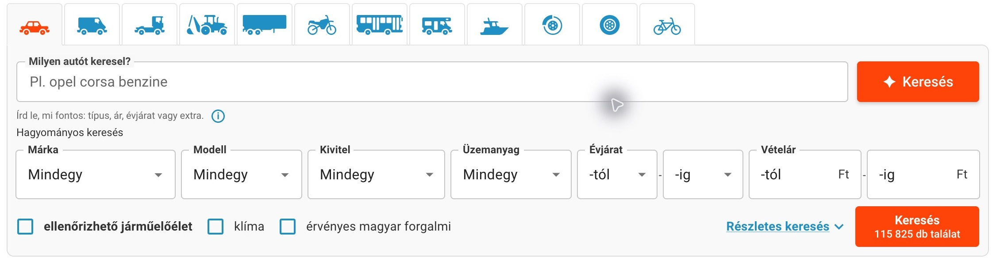
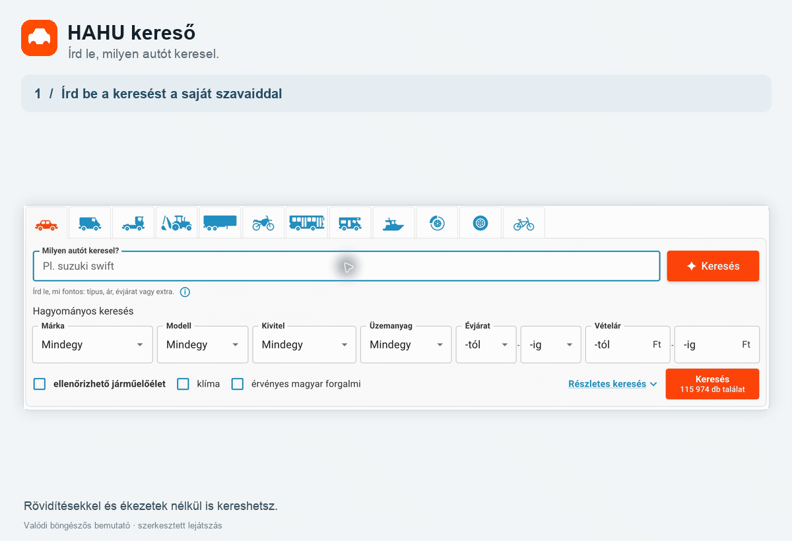

# HAHU kereső — természetes nyelvű autókeresés

## Tartalomjegyzék

- [Telepítés GitHubról](#telepítés-githubról)
- [Adatvédelem és API-kulcsok](#adatvédelem-és-api-kulcsok)
- [Licenc](#licenc)

> **Jogi nyilatkozat:** Ez egy független, nem hivatalos bővítmény. Sem a bővítmény, sem a fejlesztője nem áll kapcsolatban a Használtautó.hu-val, annak tulajdonosával vagy üzemeltetőjével.

**Írd le, milyen autót keresel. A bővítmény beállítja a szűrőket.**

A HAHU kereső természetes nyelvű keresőmezőt ad a [Használtautó.hu](https://www.hasznaltauto.hu/kereso) oldalához. A leírásodból az oldal saját keresési feltételeit állítja be, majd megnyitja a találatokat.

**Példák**

- `uj vitara`
- `golf 14tol 5mig`
- `új elektromos max 10m 150k alatt`

Egy mondatban megadhatod a márkát, a modellt, az árat, az évjáratot, a futásteljesítményt vagy a felszereltséget. Ékezetek nélkül is írhatsz. Ha egy feltételt nem sikerül beállítani, arról jelzés jelenik meg a találati oldalon. A bővítmény használatához asztali Chrome szükséges.

## Telepítés GitHubról

A használathoz Chrome és a fejlesztőtől kapott API-kulcs kell. A bővítmény közvetlenül a GitHubról tölthető le; a felhasználónak nem kell buildet készítenie vagy a backendet telepítenie.

A bővítmény a hosztolt API-hoz csatlakozik. Az API-kulcsot külön, biztonságos csatornán kérd a fejlesztőtől.

1. Töltsd le a bővítményt az alábbi módok egyikével:
   - **Ajánlott: kiadás letöltése.** Nyisd meg a [legfrissebb kiadást](https://github.com/BarniPro/ha-search-extension/releases/latest), és az **Assets** alatt töltsd le a `hahu-kereso.zip` fájlt. Ez egy rögzített verzió.
   - **A repó aktuális verziója.** A [GitHub-oldalon](https://github.com/BarniPro/ha-search-extension) válaszd a **Code → Download ZIP** lehetőséget. Ez a repó legfrissebb állapotát tölti le, amely időközben változhat.
2. Csomagold ki egy állandó mappába. Chrome-ban nyisd meg a `chrome://extensions` oldalt, kapcsold be a **Fejlesztői módot**, majd válaszd a **Kicsomagolt bővítmény betöltése** lehetőséget. A kicsomagolt, `manifest.json` fájlt tartalmazó mappát válaszd ki.
3. Nyisd meg a Chrome bővítménymenüjéből a **HAHU kereső** panelt. Illeszd be az API-kulcsot, majd válaszd az **Ellenőrzés és mentés** gombot. A panelen a hátralévő keresések száma is látható.
4. Nyisd meg vagy töltsd újra a [Használtautó keresőoldalát](https://www.hasznaltauto.hu/kereso), írd le, milyen autót keresel, majd kattints az új mező melletti **Keresés** gombra.

A kicsomagolt mappát a használat alatt tartsd meg. A kézzel telepített bővítmény nem frissül automatikusan: új verzió esetén töltsd le és csomagold ki az új ZIP-et, majd a Chrome bővítményoldalán távolítsd el a régi példányt és töltsd be az újat. Az eltávolítás törli az eszközön tárolt API-kulcsot, ezért azt újra meg kell adnod.

A keresés szövegét külső AI-szolgáltató dolgozza fel. Az AI tévedhet, ezért ellenőrizd a beállított szűrőket és a találatokat. Ha valamelyik feltételt nem sikerült beállítani, a találati oldalon erről is jelzés jelenik meg.

## Adatvédelem és API-kulcsok

- Az API-kulcs a szolgáltatás használatára jogosít, és ehhez kapcsolódik a keresési keret. A bővítmény a böngészőprofilban tárolja, ezért kezeld bizalmasan. Ha eltávolítod a bővítményből, csak erről az eszközről törlődik; a szerveroldali visszavonást a fejlesztőtől kérheted.
- A beírt keresési szöveg a háttérrendszerhez, majd azon keresztül az OpenAI-hoz kerül feldolgozásra. A bővítmény API-kulcsa a háttérrendszerhez való hozzáférést azonosítja; nem ezt továbbítja az OpenAI-nak. Használat előtt olvasd el az [OpenAI API-ra vonatkozó feltételeket](https://openai.com/policies/services-agreement/).

## Licenc

A repó saját forráskódjára és eredeti dokumentációs anyagaira az [MIT licenc](LICENSE) vonatkozik: bárki felhasználhatja, módosíthatja és terjesztheti a licenc feltételeinek betartásával. A Használtautó.hu felületét ábrázoló képernyőképek és a weboldalon megjelenő védjegyek a saját jogosultjaikhoz tartoznak; ezekre az MIT licenc nem ad további felhasználási jogot.
