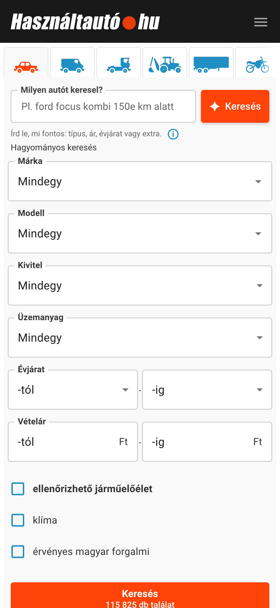
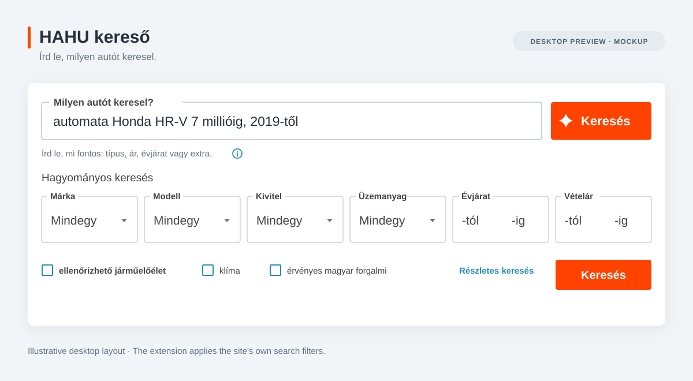

# HAHU kereső — természetes nyelvű autókeresés

<table>
  <tr>
    <th>Mobilnézet · képernyőkép</th>
    <th>Asztali előnézet · illusztráció</th>
  </tr>
  <tr>
    <td valign="top" width="25%"></td>
    <td valign="top" width="75%"></td>
  </tr>
</table>

**Írd le, milyen autót keresel. A bővítmény beállítja a szűrőket.**

A HAHU kereső természetes nyelvű keresőmezőt ad a [Használtautó.hu](https://www.hasznaltauto.hu/kereso) oldalához. A leírásodból az oldal saját keresési feltételeit állítja be, majd megnyitja a találatokat.

> automata Honda HR-V 7 millióig, 2019-től

Egy mondatban megadhatod a márkát, a modellt, az árat, az évjáratot, a futásteljesítményt vagy a felszereltséget. Ékezetek nélkül is írhatsz. Ha egy feltételt nem sikerül beállítani, arról jelzés jelenik meg a találati oldalon. Fent a Használtautó mobilnézetének képernyőképe és egy szemléltető asztali előnézet látható.

## Használat

A bővítmény használatához Chrome, működő backend és a fejlesztőtől kapott API-kulcs szükséges. A forráskódban található bővítmény helyi fejlesztői backendhez van beállítva; lásd a [Helyi fejlesztés](#helyi-fejlesztés) részt.

1. Nyisd meg a `chrome://extensions` oldalt, kapcsold be a **Fejlesztői módot**, majd válaszd a **Kicsomagolt bővítmény betöltése** lehetőséget. Éles buildhez a beállított `dist/` mappát válaszd.
2. Nyisd meg a Chrome bővítménymenüjéből a **HAHU kereső** panelt. Illeszd be az API-kulcsot, majd válaszd az **Ellenőrzés és mentés** gombot. A panelen a hátralévő keresések száma is látható.
3. Nyisd meg vagy töltsd újra a [Használtautó keresőoldalát](https://www.hasznaltauto.hu/kereso), írd le, milyen autót keresel, majd kattints az új mező melletti **Keresés** gombra.

A keresés szövegét külső AI-szolgáltató dolgozza fel. Az AI tévedhet, ezért ellenőrizd a beállított szűrőket és a találatokat. Ha valamelyik feltételt nem sikerült beállítani, a találati oldalon erről is jelzés jelenik meg.

## Éles build készítése

A buildhez Python 3.9 vagy újabb verzió szükséges; külső Python-csomag nem kell. A parancsot ebből a repóból futtasd, a backend pontos HTTPS-címét megadva:

```sh
BACKEND_ORIGIN='https://api.example.com' python3 build-extension.py dist
```

Cseréld le a példacímet a telepített backend címére. Csak az origin adható meg: útvonal, query, felhasználónév/jelszó és fragment nélkül. A build ezt a címet rögzíti a bővítményben, és lecseréli a helyi backend engedélyét. A Chrome a telepítéskor kéri a szükséges hozzáférést; a backend címe nem jelenik meg a felületen. API-kulcsot vagy más hitelesítő adatot soha ne tegyél a buildbe.

A kimeneti `dist/` mappa közvetlenül betölthető Chrome-ba. A build nem ír felül már létező kimeneti mappát. Chrome Web Store ZIP készítéséhez a `dist/` **tartalmát** tömörítsd, hogy a `manifest.json` a ZIP gyökerébe kerüljön.

## Helyi fejlesztés

A repó mappáját kicsomagolt bővítményként töltsd be. A forráskód kizárólag a `http://127.0.0.1:8080` címet használja fejlesztéshez. A manifest pontosan ezt a loopback origint engedélyezi, a háttérfolyamat pedig elutasítja az ettől eltérő HTTP-címeket. Éles buildhez rögzített HTTPS-cím szükséges.

Ha a külön, privát backend repó a `../backend` mappában van, állítsd be ott a `.env` fájlt `PROVIDER_MODE=live` értékkel és szolgáltatói API-kulccsal, majd indítsd el a Compose stacket a backend mappájából:

```sh
docker compose up --build -d
```

Éles szolgáltatói ellenőrzéshez a normál Compose stacket használd; a `compose.local.yaml` mock providert kapcsol be. Add meg a bővítményhez a fejlesztőtől kapott API-kulcsot, majd változtatás után töltsd újra a bővítményt és a Használtautó oldalát.

## Adatvédelem és API-kulcsok

- A bővítmény az API-kulcsot a `GET /v1/quota` végponton ellenőrzi, majd az `Authorization` fejlécben küldi el. A kulcs a `chrome.storage.local` tárban marad meg, így a böngésző újraindítása után is elérhető. A böngészőprofilban ezért titkos adat van.
- A kulcs bővítményből való eltávolítása csak az adott böngészőből törli azt. A szerveroldali visszavonást a fejlesztőtől kell kérni.
- Az értelmezési kérés (`POST /v1/interpret`) csak a keresés szövegét, a módot és egy átláthatatlan kérésazonosítót küldi el. A keresés szövege az aktív oldal és kérés memóriájában marad; nem kerül URL-be vagy Chrome-tárhelyre.
- A keresés átadásához a bővítmény a `POST /v1/plans/consume` végpontot használja. Az egyszer használatos token nem tartalmazza a keresés szövegét, és a felhasználása előtt eltávolítjuk az URL fragmentumából.

## A repó tartalma

Ez a nyilvános repó a bővítmény felületét, a Használtautó űrlapadapterét és a backend API-kliensét tartalmazza. A bővítmény a Használtautó részletes keresési útvonalát használja. A `quick-search-ui.js` ebben a repóban van karbantartva; a build nem olvas másik webalkalmazásból.

A promptkezelés, a járművek egyeztetése, a katalógus-pillanatképek, a kvóták, a szolgáltatói hívások és a használati adatok tárolása a különálló privát backend repóhoz tartoznak. A backend forráskódja és a szolgáltatói hitelesítő adatok nem valók ebbe a repóba. A teljes API-szerződésért és az üzemeltetési parancsokért lásd a backend repó dokumentációját.

## Licenc

Ehhez a repóhoz még nem tartozik `LICENSE` fájl. A nyilvános elérhetőség önmagában nem ad újrafelhasználási jogot; külső felhasználás vagy terjesztés előtt licencet kell választani és hozzáadni.
